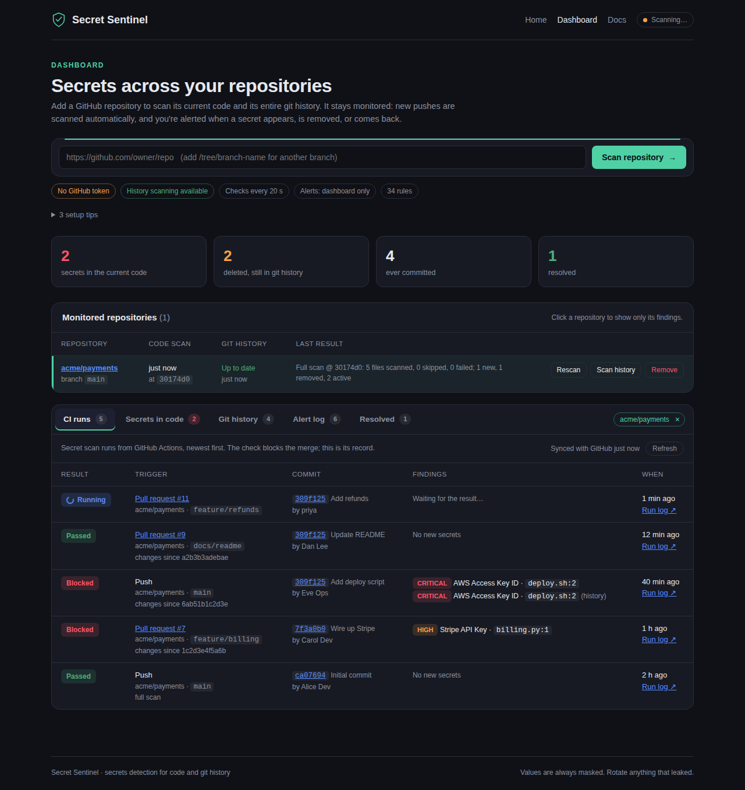
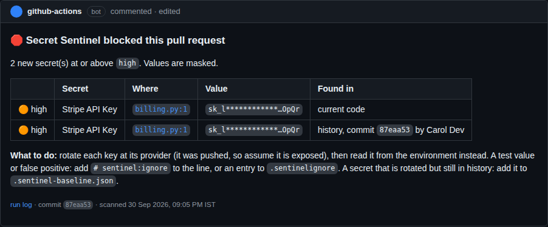
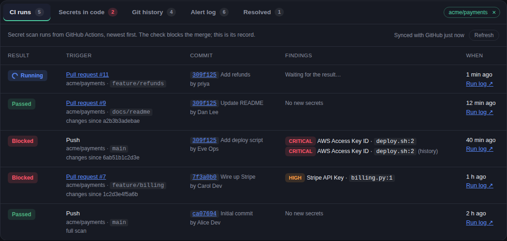
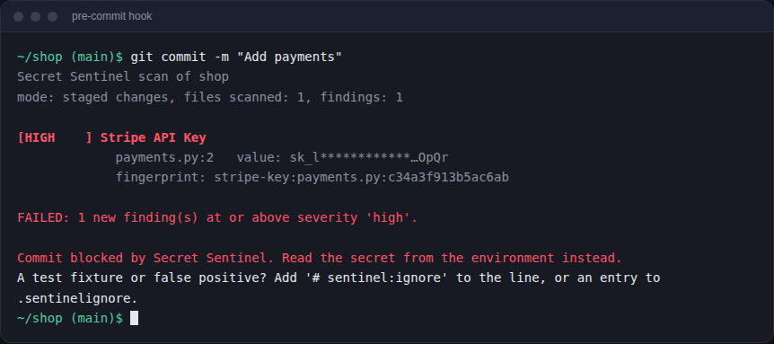
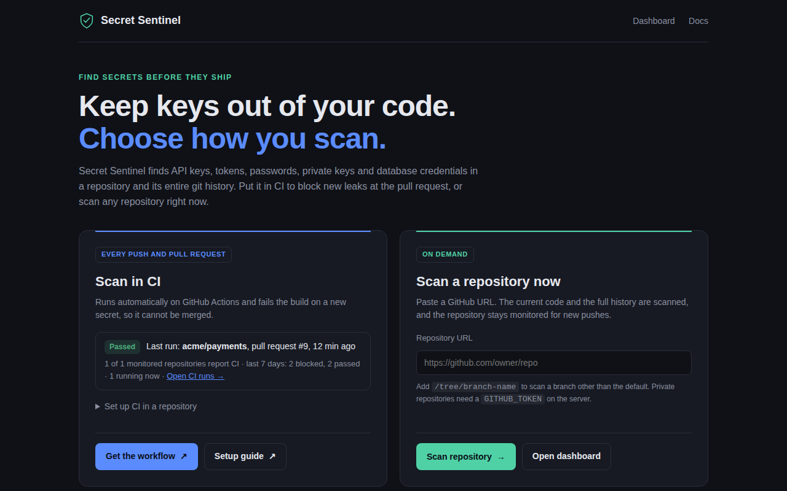
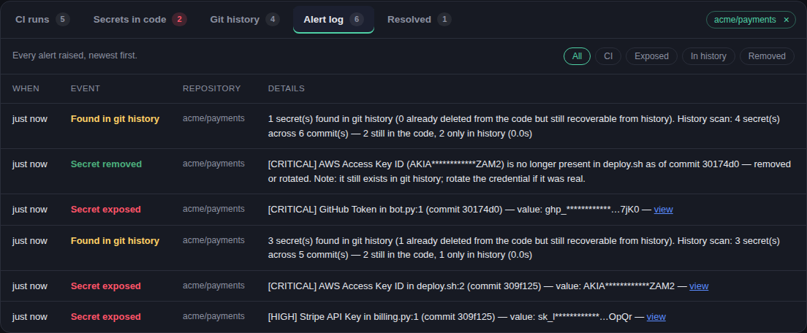
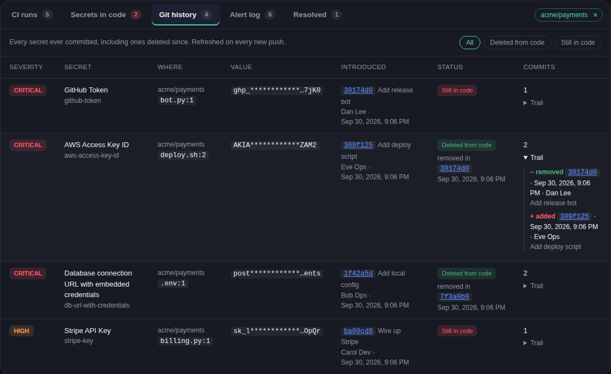

# Secret Sentinel

An automated secret-scanning pipeline. It statically analyses a codebase **and
its git history** for hard-coded credentials (API keys, tokens, private keys,
database connection strings and more), runs on every commit and pull request
in CI, alerts, and fails the build on new findings. It combines pattern
matching against known secret formats (AWS, JWT, DB URLs...) with generic
key/value rules and entropy-based detection.

There is also an optional web dashboard that watches GitHub repos and alerts
when a secret appears, when it gets removed, and when it comes back.



It works in three layers that don't overlap:

| Layer | Job |
|---|---|
| **Git hooks** | stop a secret on the developer's laptop, before it is pushed |
| **GitHub Actions** | scan every push and pull request, fail the check, block the merge |
| **Dashboard + webhook** | monitor repositories between pushes: current code, full git history, alerts |

## The CI pipeline

| Stage | What happens | Where |
|---|---|---|
| **1. CI-integrated static analysis** | Every push and pull request triggers the `Secret scan` workflow. A PR scans the files it changes; a push scans what the push changed; a new branch, the weekly schedule, or a manual run scans everything. | `.github/workflows/secret-scan.yml`, `ci/github-scan.sh` |
| **2. Secret detection engine** | 34 rules: known formats (AWS, GCP, GitHub, GitLab, Slack, Stripe, OpenAI, Anthropic, PyPI, Hugging Face, JWTs, private keys, ...), DB/JDBC/ADO.NET connection strings, generic `*_KEY=`/`password:` assignments, and Shannon-entropy checks for random-looking values in config files and string literals in code. Placeholders (`${VAR}`, `os.environ[...]`, `changeme`) are filtered out. | `app/scanner.py` |
| **3. Git history scanning** | Every added and removed line of every commit is scanned, so a secret deleted from the code but still in history is found, with the commit, author and date that introduced it and whether it is still in the code. PRs scan only their own commits. | `app/history_scan.py`, `scan-history` |
| **4. Alerting and build gating** | The job fails on any **new** finding at or above `high`, so a required status check blocks the merge. Findings appear as inline PR annotations, a job summary table, SARIF in *Security → Code scanning*, and optionally email and Slack, naming the commit's author and when it was scanned. Values are always masked. | `app/cli.py`, `app/reporting.py`, `app/policy.py` |
| **+ Code vulnerabilities** | A separate **Code vulnerabilities (Bandit)** job scans the Python code for security bugs (shell injection, unsafe deserialisation, weak crypto...) and fails on medium-or-higher severity and confidence. Being its own job, it runs even when the secret scan fails. | `.github/workflows/secret-scan.yml`, `ci/bandit_summary.py` |

**Turning it on for this repo:** it already runs. To make it block merges, go
to **Settings → Branches → Add rule** for `main`, tick *Require status checks
to pass*, and pick **Secret scan** (and **Unit tests** and **Code vulnerabilities (Bandit)**).

**Turning it on for another repo:** copy `ci/github-actions-secret-scan.yml`
to that repo as `.github/workflows/secret-scan.yml` (it fetches the scanner
from this repo; see its header). Set the
variable `SENTINEL_BANDIT=true` there to add the Bandit job too.

**Optional settings** (*Settings → Secrets and variables → Actions*):

| Name | Kind | Purpose |
|---|---|---|
| `SECRET_SCAN_FAIL_ON` | variable | `none`, `low`, `medium`, `high` (default) or `critical` |
| `SECRET_SCAN_UPLOAD_SARIF` | variable | `true` to publish findings to *Security → Code scanning* (enable code scanning first) |
| `SMTP_HOST`, `SMTP_PORT`, `SMTP_USER`, `SMTP_PASSWORD`, `ALERT_EMAIL_TO` | secrets | email a digest of new findings |
| `SLACK_WEBHOOK_URL` | secret | post new findings to Slack |
| `SENTINEL_URL` / `SENTINEL_TOKEN` | variable / secret | tell a running dashboard to refresh |
| `SENTINEL_TIMEZONE` | variable | IANA zone for times in alerts, e.g. `Asia/Kolkata` (default UTC) |
| `SENTINEL_PR_COMMENT` | variable | `false` to turn off the pull-request comment |

### Seeing what CI decided

Every run writes `result.json` (the verdict, the masked findings, the commit,
its author and the pull request) and keeps it in the run's
`secret-scan-results` artifact. Two things read it:

**A comment on the pull request.** One comment, updated on every push, lists
each blocking secret with a link to the exact line and what to do next. A clean
push turns it into "no new secrets"; a clean PR gets no comment at all. It needs
`pull-requests: write` (already in both workflows); on a fork's PR the token is
read-only, so the step warns and moves on. The check is still the gate.



**The dashboard's CI runs tab.** For every monitored repo, the dashboard reads
the Secret scan runs back from GitHub Actions: blocked or passed, which push or
pull request, the commit and its author, and the secrets that blocked it. It
pulls the results through the GitHub API, so it needs no public URL. It
refreshes on every poll and while the tab is open. A newly blocked run also
goes into the alert log. The start page shows the latest result.



For a **private** repo, the dashboard's `GITHUB_TOKEN` also needs
**Actions: Read** (fine-grained token), or the tab shows what is missing. A repo
set up before this feature needs its workflow file re-copied from
`ci/github-actions-secret-scan.yml`, so its runs upload the result. If your
workflow is not named `Secret scan`, set `SENTINEL_CI_WORKFLOW` to its name.

### Catch it before it leaves your laptop: git hooks

CI is the gate nobody can skip; git hooks give the same check on your own
machine, seconds earlier, before a secret is ever pushed (so there is nothing
to rotate). Enable them once per clone:

```bash
git config core.hooksPath .githooks
```



| Hook | Runs | Blocks when |
|---|---|---|
| `pre-commit` | before each commit | a `.env` file is staged (templates like `.env.example` are fine), or a staged line adds a secret (`scan-staged`) |
| `pre-push` | before each push | a commit being pushed adds a secret, including one committed with `--no-verify` and deleted again later (`scan-history --unpushed`) |

* Only what is new is scanned: the lines being committed, and the commits no
  remote has yet. Deleting a secret is never blocked.
* They use the same rules, `.sentinelignore`, baseline and `.sentinel-rules.json`
  as CI.
* In another repository: copy `.githooks/` there, run the `git config` line,
  and set `SENTINEL_HOME` to your Secret Sentinel checkout. If the scanner or
  `python3` is missing, the hooks warn and let the commit through.
* Hooks are optional by design: `git commit --no-verify` / `git push --no-verify`
  skip them. CI still scans the push, which is why both layers exist.

### When the build fails

1. **Rotate the credential at its provider.** It was pushed, so assume it is
   compromised. Deleting it does not help: it stays in history, clones and forks.
2. Remove it from the code (read it from the environment or a secret manager).
3. If it is a false positive or a test fixture, suppress it (see below).
   A secret that was rotated but is still in history goes in the baseline.

### Suppressing known findings

Only **new** findings fail the build. Three ways to accept one, all reviewed
in code review like any other change:

* **Inline:** add `# sentinel:ignore` (or `gitleaks:allow`) on the line.
* **`.sentinelignore`** at the repo root: a directory (`tests/fixtures/`), a
  glob (`*.snap`), a rule (`rule:high-entropy-string`), or one finding
  (`fingerprint:<id>`). Every report prints each finding's fingerprint.
* **Baseline:** record everything that exists today, so only newer findings fail:
  ```bash
  python -m app.cli scan-path .    --write-baseline .sentinel-baseline.json --fail-on none
  python -m app.cli scan-history . --write-baseline .sentinel-baseline.json --fail-on none
  ```
  Commit the file. Baselined findings are still listed, marked `baselined`.

### Your own token formats: `.sentinel-rules.json`

Add rules for formats the built-in list does not know (an internal API, a
vendor not covered yet) without touching the code. Put the file at the repo
root; `scan-path` and `scan-history` pick it up automatically (or pass
`--rules-file`), and the dashboard loads the file named by `SENTINEL_RULES_FILE`.

```json
{
  "rules": [
    {"id": "acme-api-key", "description": "Acme API key",
     "pattern": "\\b(?P<secret>acme_[A-Za-z0-9]{32})\\b", "severity": "critical"},
    {"id": "acme-session", "pattern": "\\bsess_(?P<secret>[A-Za-z0-9]{20,})",
     "severity": "medium", "min_entropy": 3.5}
  ]
}
```

* `pattern` is a Python regular expression (backslashes doubled, as JSON
  requires). A named group `secret` marks the secret part; without one, the
  whole match is the secret.
* `severity`: `low`, `medium`, `high` (default) or `critical`.
* `min_entropy` (optional) drops matches less random than that many bits per
  character, which filters out placeholders like `sess_aaaaaaaa…`.
* Custom rules run after the built-in formats and before the generic
  catch-all rules, so a custom match is reported once, under its own name.
* A broken file (bad JSON, bad regex, duplicate or built-in id) stops the scan
  with exit code 2 rather than silently scanning without your rules.

## Quick start

```bash
pip install -r requirements.txt
cp .env.example .env          # put a GITHUB_TOKEN in it (strongly recommended)
uvicorn app.main:app --port 8000
```

Open http://localhost:8000. The start page offers the two ways to use Secret
Sentinel: **Scan in CI** (setup steps and the workflow to copy) or **Scan a
repository now**. Paste `https://github.com/owner/repo` (or
`.../tree/branch-name` for a specific branch) there, or go straight to the
dashboard at http://localhost:8000/dashboard.



`.env` is loaded automatically at startup, so you don't need to export anything.

> **Upgrading from the first version?** Delete `data/sentinel.db` once. The old
> version's fingerprints weren't stable across restarts, so old rows would all
> show as "removed" and then "new" again.

### Get a GitHub token (takes a minute)

Without one, GitHub allows only **60 API requests/hour**, and scans fail fast
on anything but tiny repos. GitHub → Settings → Developer settings → Personal
access tokens → Fine-grained token → "Public repositories (read-only)" is
enough for public repos (for private repos, grant *Contents: read* on them).
Put it in `.env` as `GITHUB_TOKEN=...` and restart. The UI shows a warning
banner while no token is configured.

## Real-time alerts (no manual rescanning)

Use both: option A keeps the dashboard live seconds after a push; option B
runs in CI on every push and pull request and blocks merges. Option B needs
no public URL.

### A. GitHub webhook → instant scan + email (recommended)

The dashboard scans within seconds of a push. Needs the server reachable from
GitHub.

1. Put an SMTP config and a webhook secret in `.env`:
   ```bash
   SMTP_HOST=smtp.gmail.com
   SMTP_PORT=465
   SMTP_USER=you@gmail.com
   SMTP_PASSWORD=your-16-char-app-password   # Gmail: 2FA -> App passwords
   ALERT_EMAIL_TO=you@gmail.com
   GITHUB_WEBHOOK_SECRET=$(python3 -c "import secrets; print(secrets.token_hex(32))")
   ```
2. Start the app, then check email works — click **send test email** in the
   UI header, or run `python -m app.cli test-email`.
3. Expose it. In production that's your own domain or host; for a laptop, use
   the built-in ngrok tunnel (below) or any tunnel such as
   `cloudflared tunnel --url http://localhost:8000`.
4. In the repo: **Settings → Webhooks → Add webhook**
   - Payload URL: `https://<your-host>/webhook/github`
   - Content type: `application/json`
   - Secret: the `GITHUB_WEBHOOK_SECRET` value
   - Events: *Just the push event*

   GitHub sends a ping immediately; a green tick under "Recent Deliveries"
   means it's wired up.

Push a commit and you get an email seconds later. A repo that isn't registered
yet is added automatically on its first webhook, so you never need to paste a
URL for it. Polling stays on as a safety net for missed deliveries.

#### Built-in ngrok tunnel (dashboard on a laptop)

```bash
pip install ngrok                      # optional extra, not in requirements.txt
# .env:
#   NGROK_AUTHTOKEN=...                # dashboard.ngrok.com -> Your Authtoken
#   NGROK_DOMAIN=you.ngrok-free.dev    # optional: your free fixed domain
python -m app.serve --ngrok --port 8000
```

It opens the tunnel to the same port the dashboard runs on and prints the
Payload URL to give GitHub (`https://<domain>/webhook/github`) and the
`SENTINEL_URL` for CI notifications. **Only the two webhook routes are public:**
they authenticate themselves (HMAC signature, `SENTINEL_TOKEN`), while the
dashboard, which has no login, answers 403 to anything that came through the
tunnel and stays at `http://localhost:8000`. Set `NGROK_EXPOSE_DASHBOARD=true`
only if you really want the whole dashboard public. `NGROK_ENABLED=true` in
`.env` makes `python -m app.serve` open the tunnel without the flag.

The tunnel is optional: without it the dashboard still checks every
`POLL_INTERVAL_SECONDS` and reads CI runs from GitHub itself.

### B. GitHub Actions → scan + email on every push

No public URL, no server — it runs on GitHub's runners. This is the pipeline
described at the top of this README.

1. Copy `ci/github-actions-secret-scan.yml` into the repo you want to watch,
   at `.github/workflows/secret-scan.yml`.
2. Add repository secrets (**Settings → Secrets and variables → Actions**):
   `SMTP_HOST`, `SMTP_PORT`, `SMTP_USER`, `SMTP_PASSWORD`, `ALERT_EMAIL_TO`.
3. If you run your own copy of this project, set the `SENTINEL_REPO` variable to
   its `owner/name` (the workflow checks it out to get the scanner).

Every push and PR scans the changed files and the new commits, and emails
new findings. The build fails on anything `high` or above, which blocks merges
and triggers GitHub's own notifications. Set the `SECRET_SCAN_FAIL_ON`
variable to `none` if you only want email.

Option B can also POST results back to a running dashboard by setting
`SENTINEL_URL` (and `SENTINEL_TOKEN`), so the UI stays in sync with CI runs.

The dashboard's **Alert log** keeps every event, newest first, with filters
for exposed, found-in-history and removed:



### What the email looks like

One message per scan, not one per finding. Subject lines read like
`🔴 acme/api: 2 exposed, 1 removed (CRITICAL)`, and the body groups changes into
exposed / re-introduced / removed, each with severity, file and line, a masked
value, and a link to the exact line on GitHub. Secret values are always masked.
Set `ALERT_EMAIL_MODE=per_event` if you'd rather have one email per finding.

## Using it from the command line

```bash
python -m app.cli scan-path .                          # scan a local checkout
python -m app.cli scan-path . --diff-base HEAD~5       # only what changed
python -m app.cli scan-path . --email --fail-on critical
python -m app.cli scan-history .                       # every commit on every branch
python -m app.cli scan-history . --range main..HEAD    # only this branch's commits
python -m app.cli scan-history . --unpushed            # commits no remote has yet (pre-push hook)
python -m app.cli scan-staged .                        # lines staged for the next commit (pre-commit hook)
python -m app.cli scan-path . --sarif out.sarif --json # machine-readable reports
python -m app.cli scan-repo https://github.com/owner/repo
python -m app.cli test-email
```

`scan-path`, `scan-history` and `scan-staged` use only the standard library
(plus `git`), so CI and the git hooks need no `pip install`. All three accept `--fail-on`, `--json`, `--sarif FILE`,
`--summary FILE`, `--annotations auto|on|off`, `--email`, `--slack`,
`--ignore-file`, `--baseline` and `--write-baseline`. Inside GitHub Actions
they print annotations and write the job summary automatically.

Exit codes: 0 = no new findings at/above `--fail-on`, 1 = there are some,
2 = error.

## Git history: secrets that were deleted but are still exposed

Deleting a secret from a file does not remove it. It stays in every clone,
fork and in GitHub's UI, and stays exploitable until the credential is rotated.
So the dashboard scans two things:

* **Secrets in the current code** — what's in the files right now.
* **Git history — every secret ever committed** — every value that was ever
  added in any commit on any branch, whether or not it survives today.



The history scan starts automatically when you add a repo (set
`HISTORY_SCAN_ON_ADD=false` to opt out), runs again whenever new commits
arrive, whether picked up by the poller, a webhook or a **Rescan** (set
`HISTORY_SCAN_ON_PUSH=false` to opt out), and can be re-run any time with the
**Scan history** button, or `POST /api/repos/{id}/history-scan`. It keeps a
bare mirror clone under `data/mirrors/` and updates it with `git fetch`, so
re-scans are quick and cost no GitHub API calls.

For each unique secret the history table shows the severity and rule, the file
and line, the masked value, the commit that **introduced** it (with author,
date and message), whether it is **still in the code** or **deleted from code**
(with the commit that removed it), how many commits contain it, and an
expandable commit trail of every add and removal. Use the filter chips to see
just the deleted ones — those are the ones people usually miss.

Requires the `git` binary; the UI shows a red banner if it is missing.
`HISTORY_MAX_COMMITS` (default 5000) caps how far back a scan walks, and the
repo row says when a history was truncated.

### If a history scan finds something

Removing the file does not help. Rotate the credential at its provider, then
(optionally) purge it from history with `git filter-repo` or the BFG and force-push
— note that rewriting history rewrites every commit hash and requires everyone
to re-clone, so rotation is the step that actually protects you.

## How it works

1. **Initial scan**: when you add a repo, it resolves the branch's latest
   commit, lists every file at that commit, downloads each file and runs the
   detection rules.
2. **Continuous monitoring**: a push webhook triggers a scan immediately; a
   background job also polls every registered repo as a fallback (every 5 min
   by default, first run ~30s after startup). If the branch moved,
   it asks GitHub which files changed since the last scanned commit, re-reads
   those files at the new commit and reconciles:
   - new secret → **Secret exposed** alert
   - secret no longer in the file, or the file was deleted/renamed →
     **Secret removed** alert
   - a removed secret is back → **Secret re-introduced** alert
   - force-push / rewritten history / more than 300 files changed → falls back
     to a full rescan automatically
3. **Alerts** always show up in the UI and the console. They can also go to
   Slack, a generic webhook, or email (see `.env.example`).

Safety rule: a secret is only marked "removed" if its file was successfully
re-read, or the file no longer exists. A download failure or rate limit never
produces a false "removed" alert. The error shows up on the repo row instead.

## What it detects

It has 34 rules. The main groups:

* **Database URLs**: postgres, mysql, mariadb, mongodb(+srv), redis, amqp,
  mssql, oracle, and more, including SQLAlchemy-style `postgresql+psycopg2://`.
  URLs with credentials (`user:pass@host`, `?password=`) are **critical**.
  URLs that expose only a host or database are **medium**. JDBC and ADO.NET
  (`Server=...;Password=...`) connection strings are covered too.
* **Vendor keys**: AWS (access key and secret), Google API / OAuth / service
  account, GitHub, GitLab, Slack (tokens and webhooks), Discord webhooks,
  Stripe, OpenAI, Anthropic, Twilio, SendGrid, Mailgun, npm, PyPI, Hugging
  Face, Shopify, DigitalOcean, Telegram bots, Azure Storage keys and SAS
  tokens, JWTs, and private key blocks.
* **Generic hard-coded secrets**: any variable or key ending in `key`,
  `password`, `secret`, `token`, `api_key`, `access_key`, `client_secret`,
  `private_key`, `credentials`, `dsn`, `auth`, `passphrase`, `pwd` and similar.
  It works with or without quotes, with prefixes (`DB_PASSWORD`, `AWS_KEY`,
  `STRIPE_API_KEY`), and in `.env`, YAML, JSON, INI and source code.
* **High-entropy values in config files**: a catch-all for credentials whose
  variable name no rule knows (`SENTRY_DSN_TOKEN`, `TWILIO_SID`...). Only runs
  on `.env`/`.yml`/`.json`/`.ini`-style files, skips keys whose values are
  normally random but harmless (`sha`, `hash`, `integrity`, `version`, `uuid`,
  `etag`...), and requires mixed character classes, so version strings and
  checksums don't trigger it.
* **High-entropy string literals in code** (low severity): a quoted value of
  24+ characters mixing upper case, lower case and digits with Shannon entropy
  of at least 4.2 bits/char, assigned to anything. It is reported but does not
  fail a default (`high`) build, since code also holds legitimate random
  strings. Hex hashes don't match (too few character classes).

It ignores the usual false positives: `os.environ.get(...)`, `process.env.X`,
`${VAR}`, `password: str` type hints, `your_api_key` / `changeme`
placeholders, and variable-to-variable assignments in code.

**Not sure if a test secret will be caught?** Put it in a file and run
`python -m app.cli scan-path <folder>`, or `POST /api/test-scan` with
`{"content": ..., "filename": ...}`. Both run the same rules locally and don't
touch GitHub.

## Troubleshooting "it doesn't detect anything"

| Symptom | Cause / fix |
|---|---|
| Red "rate limit" error on the repo row | Set `GITHUB_TOKEN` in `.env` and restart. |
| "Not found" error | Typo in the URL, or a private repo without a token that can read it. |
| Test file is on a feature branch | The current-code scan covers the default branch unless you add `.../tree/<branch>`. The history scan covers `--all` branches regardless. |
| A secret you deleted isn't listed | Look in the **Git history** tab: the current-code scan only sees today's files. If the history scan is off or failed, click **Scan history**. |
| Only one finding where you expected several | Identical values in the same file are one finding (deduplicated). Different values, files or rules are listed separately. |
| History scan says "unavailable" | `git` isn't installed on the server. |
| "N file(s) could not be downloaded" | Network or permissions issue for those files. Check the console logs. |
| A test value isn't detected | It matched no rule, or looked like a placeholder (`changeme`, `your_key`, `${VAR}`). Try a realistic value. |
| Pushed a change but no alert yet | Without a webhook, polling runs every `POLL_INTERVAL_SECONDS` (default 300). Click **Rescan** for an immediate check, or set up the webhook above. |
| Webhook delivery shows 401 | `GITHUB_WEBHOOK_SECRET` and the secret in GitHub's webhook settings don't match. |
| No email arrives | Run `python -m app.cli test-email` and read the error. Gmail needs an App Password, not your account password. Check spam. |
| Emails are too noisy | Default is one digest per scan. Raise `--fail-on`, or remove rules in `app/scanner.py`. |

## Tests

No extra dependencies are needed. The end-to-end test runs the real pipeline
against a local fake GitHub API.

```bash
python3 -m tests.test_scanner         # 47 detection / false-positive cases
python3 -m tests.test_pipeline_e2e    # push → edit out → delete → re-add → rate limit → force-push
python3 -m tests.test_ci_and_alerts   # SMTP email, the CI CLI, webhook auth & routing
python3 -m tests.test_gating          # history ranges, ignore file, baseline, SARIF, annotations, gate
python3 -m tests.test_custom_rules    # .sentinel-rules.json, commit author and local time in alerts
python3 -m tests.test_hooks           # the git hooks, through real git commit / git push
python3 -m tests.test_history         # history scanning: deleted secrets, attribution, refresh on push
python3 -m tests.test_ci_runs         # result.json, the PR comment, the CI runs tab (fake Actions API)
```

### Try the dashboard without GitHub

The screenshots in this README were taken this way, from the demo repository
after one push that rotates the AWS key and adds a GitHub token.

```bash
python3 -m tests.demo_server          # then open http://localhost:8000/dashboard
```

This serves a fake GitHub from local git repositories and prints the path of a
demo repo, `acme/payments`, whose history already contains leaked and deleted
secrets. Paste `https://github.com/acme/payments` into the dashboard, then
commit into the printed path and click **Rescan** to watch every tab update.
Everything lives in a temporary directory: no GitHub calls and no emails.

The email tests run against a fake SMTP server on localhost, so nothing is
sent anywhere. `test_ci_and_alerts` needs `fastapi` installed for the webhook
section; the rest run on the standard library alone.

## API

| Method | Path | Purpose |
|---|---|---|
| POST | `/api/repos` `{"url": ...}` | Register a repo and run a full scan |
| GET | `/api/repos` | Repos, with last scan summary and last error |
| POST | `/api/repos/{id}/rescan?full=true` | Manual rescan (`full=false` = only new commits) |
| DELETE | `/api/repos/{id}` | Stop monitoring a repo |
| GET | `/api/findings?repo_id=&status=active\|removed` | Findings |
| GET | `/api/alerts?repo_id=` | Alert log |
| POST | `/api/test-scan` `{"content", "filename"}` | Run the rules on pasted text |
| POST | `/api/test-email` | Send a test email |
| POST | `/api/repos/{id}/history-scan?wait=` | Walk all git history for secrets |
| GET | `/api/history?repo_id=&presence=present\|history_only` | Every secret ever committed, with commit trail |
| GET | `/api/history/stats` | Totals: ever committed / still present / deleted |
| GET | `/api/status` | Token, alert-channel and polling configuration |
| POST | `/webhook/github` | GitHub push webhook (HMAC-verified) |
| POST | `/webhook/ci` | Notification from a CI job (`X-Sentinel-Token`) |
| GET | `/api/ci-runs?repo_id=` | Secret scan runs read back from GitHub Actions |
| POST | `/api/ci-sync?repo_id=` | Refresh CI runs from GitHub now (throttled per repo) |
| GET | `/api/ci-summary` | Latest CI result and 7-day counts (the start page) |

## Docker

```bash
docker build -t secret-sentinel .
docker run -p 8000:8000 --env-file .env -v $(pwd)/data:/app/data secret-sentinel
```

## Limitations

* History scanning skips merge commits (their content comes from the parents,
  which are scanned) and walks at most `HISTORY_MAX_COMMITS` commits.
* A history scan needs disk space for a bare mirror of the repo.
* Removing a secret from the repo doesn't make it safe: it stays in git
  history and in any forks or clones. If it was real, rotate it.
* Detection is regex-based. Add rules in `app/scanner.py` (`RULES`) and a
  test case in `tests/test_scanner.py`.
* The webhook needs the server reachable from GitHub. Behind a firewall, use
  the GitHub Actions option instead — it pushes results out rather than
  waiting to be called.
